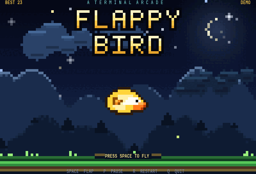
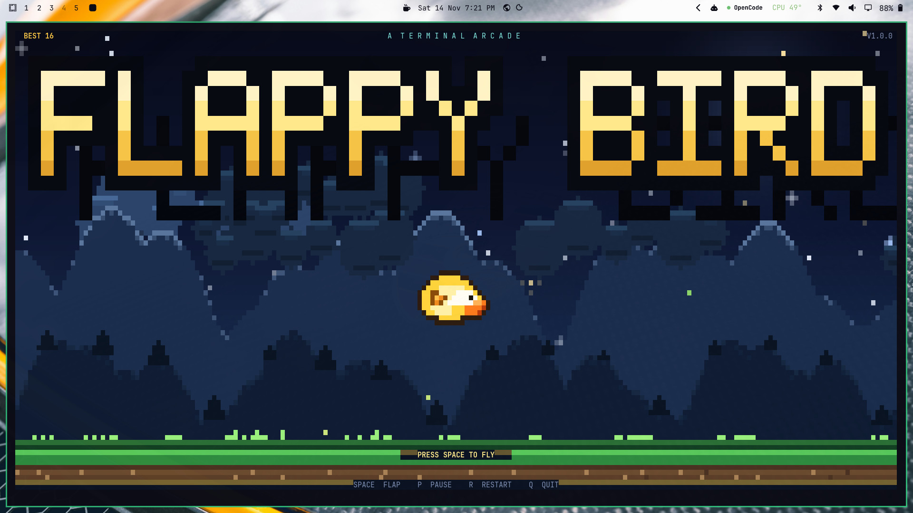
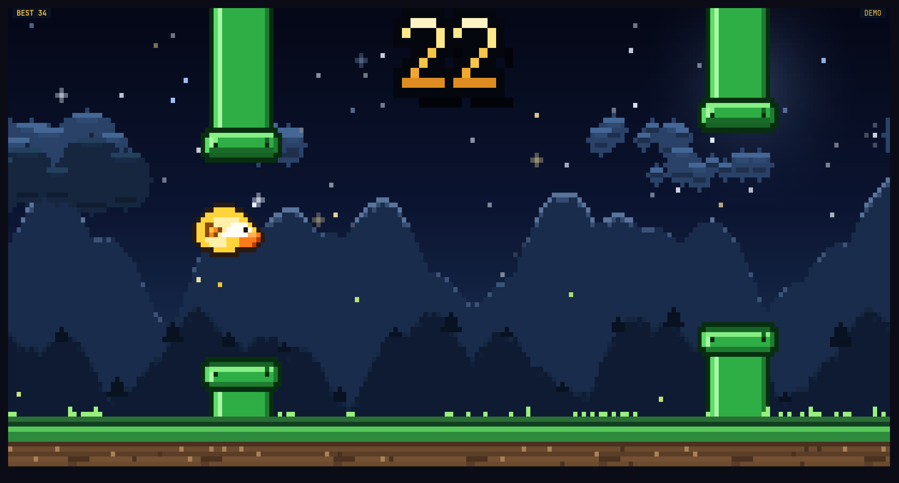
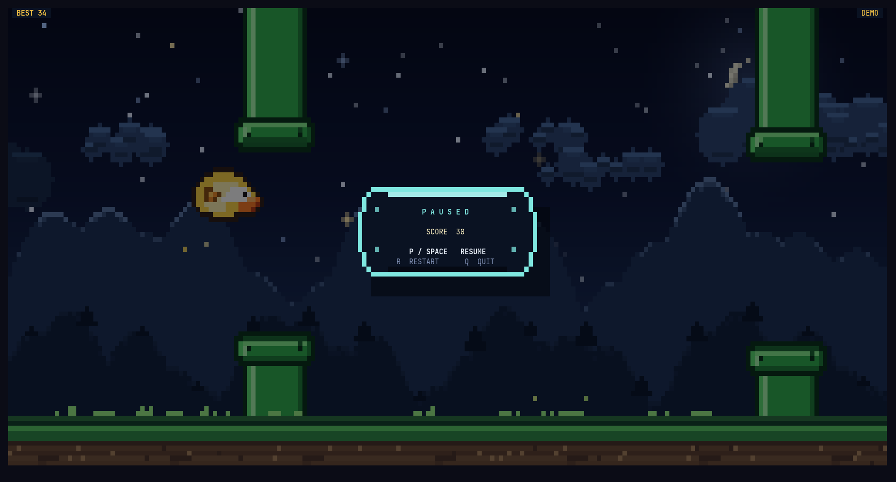
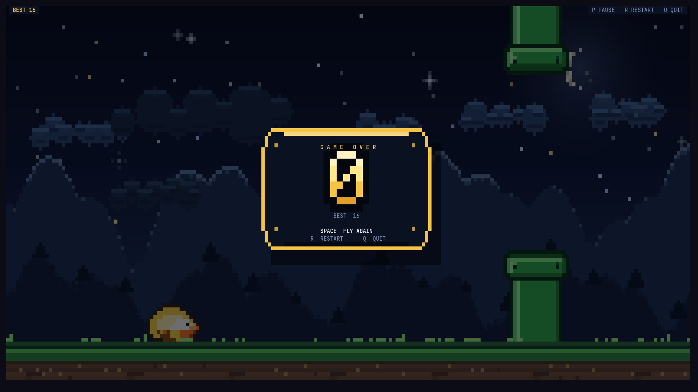
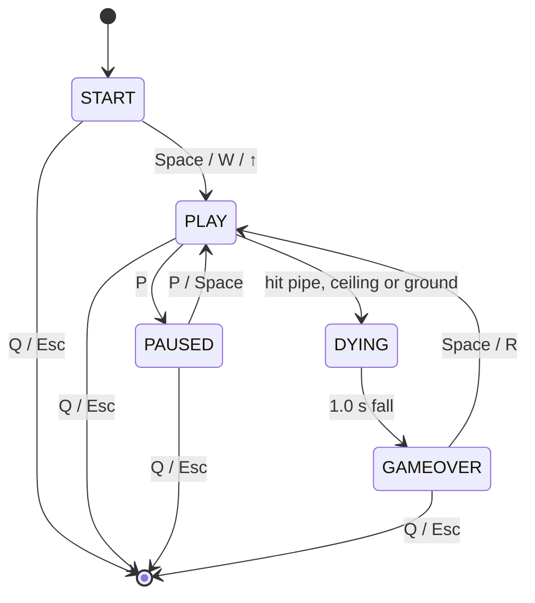
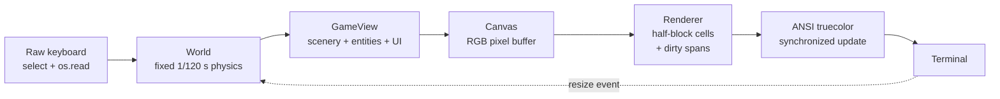
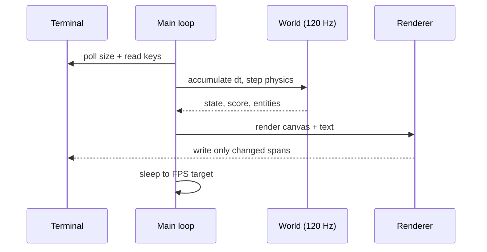

# terminal-bird 🐤

A full arcade **Flappy Bird clone that lives inside your terminal**.
No browser, no window, no images, no network — just Python 3 and the
standard library, drawing everything with ANSI truecolor and Unicode
half-block characters.



<p align="center">
  
  
  
  
</p>

---

## Highlights

- 🐦 Hand-drawn 17×11 pixel bird with three wing frames, an eye, a beak and a
  tilt animation
- 🌌 Animated night scene: gradient sky, twinkling stars, a cratered crescent
  moon with a glow halo, parallax clouds, snow-capped ridges and pine trees
- 🟢 Bright green pipes with rounded caps, highlights, shadows and rivets —
  procedurally spawned with fair, reachable gaps
- 🎮 Real arcade physics at a fixed 120 Hz timestep, rendered at up to 60 FPS,
  fully frame-rate independent
- 🏆 Persistent high score plus game counter in your XDG data directory
- 📐 Adapts live to any terminal size — minimum 40×16, tested up to 200×55
- ✨ Particles, feathers, fireflies, shooting stars and screen shake on impact
- 📦 **Zero dependencies** — pure Python 3 standard library, no `curses`
- ⚡ Span-based dirty-cell rendering keeps output around 3 KB per frame at
  80×24 instead of repainting the whole screen
- 🖥️ Restores your terminal cleanly on quit, Ctrl-C, or window resize

---

## Installation

### Linux / macOS / BSD (one line)

```bash
curl -fsSL https://raw.githubusercontent.com/Abdulhadi446/terminal-bird/main/install.sh | bash
```

Or clone and install locally:

```bash
git clone https://github.com/Abdulhadi446/terminal-bird.git
cd terminal-bird
./install.sh              # installs into ~/.local/bin
```

System-wide (needs write access to `/usr/local/bin`):

```bash
sudo ./install.sh --system
```

Custom prefix:

```bash
./install.sh --prefix "$HOME/.bin"
```

The installer also creates a desktop entry so Terminal Bird shows up in your
application menu.

### Windows

Terminal Bird uses `termios` for raw keyboard input, so it needs a POSIX
terminal. Run it inside **WSL**:

```bash
sudo apt install python3
git clone https://github.com/Abdulhadi446/terminal-bird.git
cd terminal-bird
python3 flappy.py
```

### Manual (any POSIX system)

```bash
git clone https://github.com/Abdulhadi446/terminal-bird.git
cd terminal-bird
chmod +x flappy.py
./flappy.py
# or
python3 flappy.py
```

### Try it without installing

```bash
python3 flappy.py
```

---

## Controls

| keys | action |
|------|--------|
| `Space` / `W` / `↑` / `Enter` | flap |
| `P` | pause / resume |
| `R` | restart immediately |
| `Q` / `Esc` / `Ctrl-C` | quit and restore the terminal |

Input is read instantly in raw mode — no Enter required.

---

## Options

| flag | effect |
|------|--------|
| `--color {auto,truecolor,256,16}` | force a colour depth (default: auto-detect) |
| `--fps N` | render frame cap, 20–120 (default: 60) |
| `--seed N` | fixed seed for reproducible pipe layouts |
| `--autopilot` | the bird flies itself; press Space to start |
| `--demo` | autoplay and auto-restart forever — handy for recording GIFs |
| `--no-save` | never write the high-score file |
| `--reset-best`, `--reset-score` | erase the saved high score and exit |
| `--version` | print the version and exit |
| `--debug` | show an FPS / timing overlay (hidden flag) |

`--demo` implies `--no-save`, so recordings never pollute your real score.

---

## Screenshots

| Title | Gameplay |
|---|---|
|  |  |

| Paused | Game over |
|---|---|
|  |  |

---

## How it works

### Game states



### Runtime pipeline



### Frame timing



### Architecture in one paragraph

`World` owns all gameplay and never touches the terminal, which makes it fully
unit-testable. `GameView` turns the world into an RGB `Canvas` (two vertical
pixels per terminal cell) plus coloured text overlays. `Renderer` compresses the
canvas into Unicode half-block cells (`▀`), compares them with the previous
frame, and emits only the dirty column spans using ANSI 24-bit colour inside a
synchronized-update block (`\x1b[?2026h` … `\x1b[?2026l`), which prevents
flicker and tearing. A `TerminalSession` puts the tty in raw mode and restores it
via `atexit` and signal handlers.

---

## Project structure

```
terminal-bird/
├── flappy.py             # the entire game (single file, stdlib only)
├── install.sh            # user / system / prefix installer
├── run.sh                # convenience launcher
├── tests/
│   └── test_flappy.py    # unittest suite
├── assets/
│   ├── demo.gif
│   ├── start.png
│   ├── play.png
│   ├── pause.png
│   └── gameover.png
├── README.md
└── .gitignore
```

---

## Tuning constants

The interesting knobs live near the top of `World.configure()` and
`World.current_*()` in `flappy.py`:

```python
# geometry
ground_h   = max(5, min(14, round(H * 0.095)))
sky_h      = H - ground_h
bird_w, bird_h = 17, 11          # scaled ×2 when sky_h >= 100
pipe_w     = max(8, round(sky_h * 0.185))
gap_base   = clamp(round(sky_h * 0.52), bird_h + 7, sky_h * 0.62)
gap_min    = max(bird_h + 5, round(gap_base * 0.76))

# motion (all scaled to sky height so every terminal feels the same)
gravity    = sky_h * 2.6
flap_power = -sky_h * 1.08
max_fall   = sky_h * 1.4

# difficulty ramps with score
speed      = base_speed * (1 + 0.0125 * min(score, 55))
gap        = max(gap_min, gap_base * max(0.76, 1 - 0.0052 * min(score, 55)))
interval   = max(1.08, 1.55 - 0.0082 * min(score, 55))

# collision is forgiving: inset the sprite by 4 px horizontally, 3 px vertically
hitbox = (bird.x + 4 * bs, bird.y + 3 * bs,
          bird.w - 8 * bs, bird.h - 6 * bs)
```

The simulation runs at a fixed `1 / 120` second step with an accumulator, so
physics stay identical whether you render at 20, 60 or 120 FPS.

---

## Game details

- **Pipes** spawn from the right, scroll left, and score one point when their
  centre passes the bird. Consecutive gaps are limited to ±26 % of the sky
  height so every pipe is reachable.
- **Difficulty** rises smoothly: speed grows, gaps shrink, and spawn intervals
  shorten until the caps at score 55.
- **High score** is stored at
  `~/.local/share/terminal-bird/highscore.json`, or under `TERMINAL_BIRD_DATA`
  if that environment variable is set. Writes are atomic.
- **`--demo`** never touches the score file; normal play does.
- **The bird hitbox** is deliberately smaller than the sprite, so wing tips and
  the beak can clip a pipe without killing you.
- **Terminal safety**: raw mode is restored on every exit path, including
  `SIGINT`, `SIGTERM`, `SIGHUP` and unhandled exceptions.

---

## Compatibility

- Python **3.9+**
- POSIX terminal with `termios` (Linux, macOS, BSD, WSL)
- Tested terminals: `foot`, `alacritty`, `kitty`, `wezterm`, `xterm-256color`,
  `tmux`
- Colour: 24-bit truecolor is recommended; 256-colour and 16-colour fallbacks
  are built in
- Minimum window: **40 columns × 16 rows**; the game shows a friendly resize
  prompt below that

---

## Development

```bash
# run the test suite
python3 -m unittest discover -v tests/

# record a demo GIF (needs ImageMagick + a terminal)
python3 flappy.py --demo
```

---

## Credits

Inspired by Dong Nguyen's *Flappy Bird*. All sprites, scenery and UI in this
project are original block-art drawn in code. Built for the joy of making a
terminal feel like an arcade cabinet.

## License

MIT
